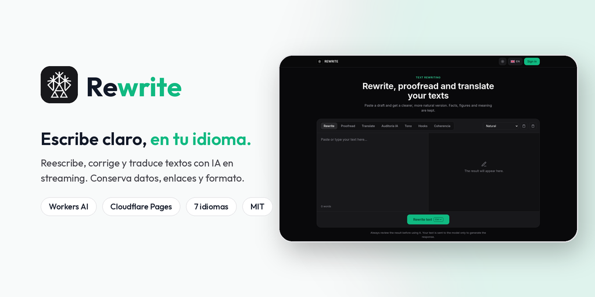
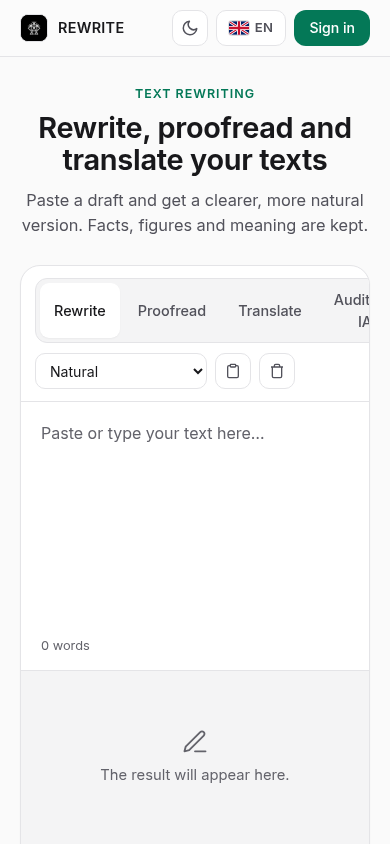

<p align="center">
  
</p>

<p align="center">
  <strong>Editor con IA para reescribir, corregir y traducir textos. Conserva datos, enlaces y formato Markdown.</strong><br/>
  <em>AI text editor to rewrite, proofread and translate, with streaming output (UI in 7 languages).</em>
</p>

<p align="center">
  <a href="https://rewrite.trujillomingorance.com"><b>rewrite.trujillomingorance.com</b></a> ·
  <a href="https://trujillomingorance.com">trujillomingorance.com</a> ·
  <a href="LICENSE">Licencia MIT</a>
</p>

<p align="center">
  
  
  
  
</p>

---

## Capturas

| Escritorio | Móvil |
|:-:|:-:|
|  |  |

## Funciones

- **Reescribir:** cuatro estilos (Natural, Académico, Sencillo y Resumen ejecutivo). Mantiene cifras, nombres, enlaces y Markdown. Si el resultado sale demasiado corto (menos del 85 % de las palabras), se regenera una vez con una instrucción más firme.
- **Corregir:** ortografía, gramática y estilo. Los textos de hasta 300 palabras usan un modelo pequeño y rápido (GPT-OSS 20B en Groq).
- **Traducir:** español, inglés, catalán, francés, alemán, italiano y portugués.
- **Herramientas extra:** Tono, Hooks, Coherencia y Auditoría del texto (usan Groq; si falla, se usa el servicio de IA de trujillomingorance.com).
- **Streaming:** el resultado aparece mientras se genera (SSE).
- **Cambios en el estilo:** panel calculado en tu navegador que compara el original con el resultado (longitud, frases y variedad).
- **Interfaz en 7 idiomas** con banderas SVG propias (Windows no pinta los emoji de bandera). Recuerda el idioma elegido.
- **Cuenta común de trujillomingorance.com:** acceso con X, Google o correo y menú de cuenta (perfil, ajustes, logros). Las cuentas internas de Microsoft Entra ID ven además el enlace «Panel interno».
- **Diseño** de trujillomingorance.com: fuente Outfit autoalojada, zinc y menta, claro u oscuro según el sistema.

Revisa siempre el resultado antes de usarlo. No está pensado para ocultar la autoría de un texto ni para saltarse normas académicas.

## Stack

| Capa | Tecnología |
|---|---|
| Frontend | HTML, CSS y JavaScript sin framework ni paso de build (`public/`) |
| Hosting | **Cloudflare Pages** (estáticos + cabeceras en `_headers`) |
| API | **Cloudflare Pages Functions** (`functions/`), solo en `/api/*` (`_routes.json`) |
| IA | **Groq** (principal): GPT-OSS 120B, con GPT-OSS 20B y Qwen3 como respaldo (GPT-OSS 20B para correcciones cortas). **Workers AI** (Llama 3.3 70B / 3.1 8B) solo como último recurso |
| Sesión | Cookie compartida en `.trujillomingorance.com`, verificada por el servicio de sesión común |

## Arquitectura

```mermaid
flowchart LR
  U["Navegador<br/>rewrite.trujillomingorance.com"]
  subgraph Cloudflare
    P["Pages<br/>HTML · CSS · JS"]
    F["Functions /api/*<br/>origen · tamaño · ritmo"]
    AI["Workers AI (último recurso)<br/>Llama 3.3 70B · 3.1 8B"]
  end
  S["Servicio de sesión común<br/>*.trujillomingorance.com"]
  G["Groq (principal)<br/>GPT-OSS 120B · 20B · Qwen3"]

  U -->|estáticos| P
  U -->|/api/rewrite (SSE)| F
  F -->|GROQ_API_KEY| G
  F -.->|si Groq falla| AI
  U -->|/api/auth/me| F
  F -->|solo si hay cookie| S
```

| Ruta | Qué hace |
|---|---|
| `POST /api/rewrite` | Reescribir, corregir o traducir. Con `stream: true` responde en SSE |
| `POST /api/humanize` | Alias de `/api/rewrite` |
| `POST /api/tools` | Tono, Hooks, Coherencia y Auditoría (Groq) |
| `POST /api/analyze` | Métricas de texto calculadas sin IA |
| `GET /api/auth/*` | Inicio de sesión (X, Google, Microsoft), `me` y `logout` delegados al servicio de sesión común |
| `GET /api/admin/summary` | Estado para el panel interno (solo sesión interna de Microsoft) |

## Seguridad y consumo

- **Sin secretos en el repositorio.** Este proyecto no firma sesiones: no necesita `JWT_SECRET`.
- **Endpoints de IA protegidos:** solo aceptan peticiones de navegador desde `*.trujillomingorance.com` (y las vistas previas de Pages), texto de 12 000 caracteres como máximo y 30 peticiones cada 10 minutos por IP. Sin KV ni D1, así que la protección no añade operaciones facturables.
- **Tokens acotados:** el tope de salida es proporcional al texto de entrada.
- **`/api/auth/me` anónimo** responde al momento, sin subpetición.
- **Cabeceras:** CSP, HSTS con preload, `X-Frame-Options: DENY`, `nosniff`, Referrer-Policy y Permissions-Policy.
- **Privacidad:** el texto se envía al modelo solo para generar la respuesta; no se guarda historial en el servidor.

## Desarrollo local

Requisitos: **Node.js ≥ 20** y `npx wrangler login` (Workers AI necesita cuenta).

```bash
git clone https://github.com/ATM-Software-Labs/rewrite-ai.git && cd rewrite-ai
npm run dev      # wrangler pages dev public → http://localhost:8788
npm test         # node --test tests/
```

| Comando | Qué hace |
|---|---|
| `npm run dev` | Pages + Functions en local con Wrangler |
| `npm test` | Pruebas (`tests/*.test.mjs`) |
| `npm run deploy` | `wrangler pages deploy public --project-name=rewrite-ai` |

## Despliegue

El proyecto de Cloudflare Pages `rewrite-ai` está conectado a GitHub: cada push a `main` despliega en producción y las ramas generan vistas previas (salvo `dependabot/*`). Dominio: `rewrite.trujillomingorance.com`.

### Variables y bindings (solo nombres)

| Nombre | Tipo | Uso |
|---|---|---|
| `AI` | binding Workers AI | Respaldo de último recurso |
| `BOT_MEMORY` | binding KV | Reservado (compartido con el resto de webs) |
| `DEFAULT_MODEL` | variable | Modelo de Workers AI para el respaldo (por defecto Llama 3.3 70B) |
| `ENVIRONMENT` | variable | `production` |
| `GROQ_API_KEY` | secreto | Proveedor principal (Groq) para reescribir, corregir, traducir y las herramientas extra |

## Estructura

```
public/              index.html, 404.html, _headers, _routes.json, css/, js/ (app, i18n, flags), img/
functions/api/       rewrite.js, humanize.js, tools.js, analyze.js, auth/, admin/
functions/lib/       guard.js (origen, tamaño y ritmo)
tests/               pruebas con node --test
docs/                banner y capturas
```

## Licencia

[MIT](LICENSE) © 2026 Alberto Trujillo Mingorance. Fuente Outfit bajo SIL OFL 1.1.

<p align="center"><sub>© 2026 ATM Software Labs · <a href="https://trujillomingorance.com">trujillomingorance.com</a></sub></p>
